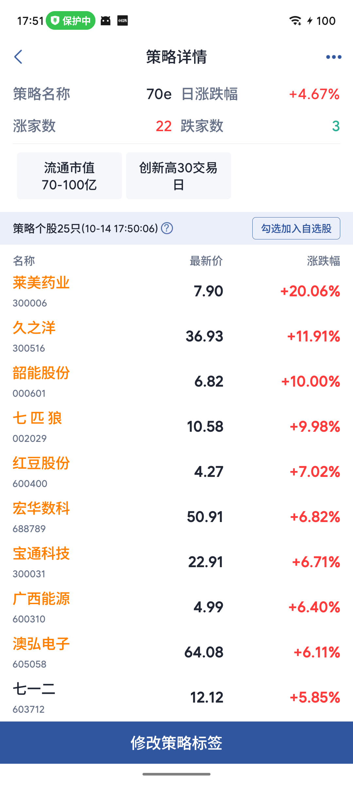
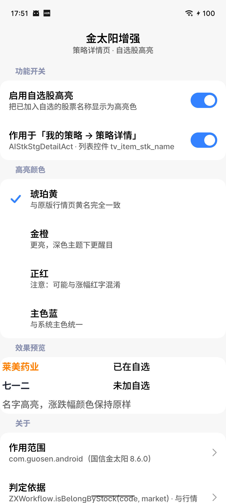

<div align="center">

# GSAuxiliary

**国信金太阳「策略详情页」自选股高亮 — LSPosed 模块**

Make GoldenSun Great Again！

让「我的策略 → 策略详情」里已加入自选的股票，名称显示为黄名，和「行情」页保持一致。


</div>

---

## 效果

| 策略详情页（模块生效后） | 设置界面 |
|---|---|
|  |  |

- 莱美药业 / 久之洋 / 韶能股份 … → **名称黄名**（已在自选）
- 七一二 → 深色（未加自选）
- **涨跌幅颜色保持原样**，涨红跌绿不受影响

---

## 它解决什么问题

| 页面 | 已加自选的股票 | 未加自选的股票 |
|---|---|---|
| 行情 → 自选列表 | **名称黄名** | 深色 |
| 我的策略 → 策略详情 | ~~深色，看不出来~~ → **现在也是黄名** | 深色 |

原版里，策略详情页只能点进个股、看底部按钮是「自选 +」还是「自选 -」才能判断。
本模块让名称直接变黄，一眼分辨。

> 原版两个页面用的是**同一个 `StockInfo` 类**，只是策略页的数据源没有填充 `isZx` 字段，
> 所以永远不黄。本模块不改数据，只在视图渲染后补一次判定 —— 详见 [Hook 难点](docs/HOOK-NOTES.md)。

---

## 功能特性

- ✅ 策略详情页自选股名称高亮，与行情页视觉一致
- ✅ **策略详情页点股票直达「标准行情」**：跳过原版的个股介绍中间页，一步进个股详情
  （原来要多点一次「标准行情」），详见 [实现方案](docs/FEATURE-DIRECT-QUOTE.md)
- ✅ **个股详情页左右滑动切换股票**：与「行情 / 自选」列表点进去的手感一致
- ✅ **只染名称**，不动涨跌幅、不动其它任何 UI
- ✅ 4 种预设高亮色：琥珀黄（默认，与原版完全一致）/ 金橙 / 正红 / 主色蓝
- ✅ 总开关 + 作用域开关，**关闭后立即还原**，不留残留
- ✅ 设置**立即生效**，不用重启、不用手动刷新
- ✅ 模块升级后可**热重载**目标进程，无需重启金太阳
- ✅ 设置界面用 [Miuix](https://github.com/miuix-kotlin-multiplatform/miuix)（小米 HyperOS 风格）Compose 编写
- ✅ **液态玻璃悬浮底栏**（**默认开启**）：真正浮在内容之上（内容延伸到底栏之下供玻璃采样 + 外投影），
  可在它与 Miuix 默认底栏之间切换（参考 [AndroidLiquidGlass](https://github.com/Kyant0/AndroidLiquidGlass)）；
  支持顶部高光 / 内阴影光效开关、选中项滑动指示、长按 Tab 弹出名称气泡
- ✅ **主题设置**：跟随系统 / 亮色 / 暗色，与语言设置同样式
- ✅ **可预测返回**（**默认开启**）：Android 13+ 二级页返回跟手预览，一级菜单实时从下方露出
- ✅ **功能二级菜单**：功能页只放开关，打开后才展开该功能的「XX设置」入口
- ✅ **功能出厂全部关闭**：功能菜单里每一个开关默认都是**关**，由用户按需打开；
  功能**二级菜单里的参数**保持默认开启（能进二级菜单，说明总开关已经打开了）
- ✅ 语言可切（跟随系统 / 简体中文 / English）、配置可备份恢复（文件名带日期时间）、日志可查看
- ✅ 不修改、不上传、不拦截任何数据，纯本地显示层处理

---

## 安装

**前置条件**

- 手机已 root，并已安装 [LSPosed](https://github.com/LSPosed/LSPosed)（需支持 **API 102**）
- 目标 App：**国信金太阳 8.6.0**（`com.guosen.android`）
- Android 8.1+（`minSdk 27`）

**步骤**

1. 从本仓库的 **Releases** 页面下载 `app-release.apk` 并安装（或自行构建，见[构建](#构建)）
2. 打开 LSPosed 管理器 → **模块** → 勾选 **GSAuxiliary**
3. **作用域**勾选 `国信金太阳`（模块已固定声明作用域，正常会自动勾上）
4. 强制停止国信金太阳，重新打开一次

> 首次启用后需要重启一次目标 App —— LSPosed 在**进程启动时**加载模块。
> 之后再改设置、再升级模块 APK，都**不需要**重启金太阳了。

---

## 使用

1. 打开 **GSAuxiliary** App（即模块的设置界面）
2. 切到「**功能**」页，打开 **启用自选股高亮** 的开关
3. 开关下方会展开「**染色设置**」入口，点进去调整：
   - **作用于策略详情页** — 作用域开关
   - **高亮颜色** — 4 种预设
   - **效果预览** — 即时预览染色效果
4. 切回国信金太阳，进入
   `首页 → 智能选股 → 我的策略 → 任一策略 → 策略详情`
5. 已在自选的股票名称即为高亮色

改完设置**不用重启**：配置由框架推送到目标进程，值一变就立刻刷新列表。

界面分四个板块，用底部 Dock 切换（玻璃 / 纯色形态在设置页的「材质设置」里切换）：

| Tab | 内容 |
|---|---|
| 概览 | **顶部状态卡**（已激活 / 未激活 + 大对勾 + 框架版本 / API）+ 两个分组：**模块**（版本 / 构建时间）、**运行环境**（安卓 / 设备 / Miuix） —— **只读展示，一屏看完** |
| 功能 | 功能菜单，**搜索框挂在顶栏**（滚动时不会滑走）；每个功能一个开关，打开后展开其二级设置入口 |
| 设置 | **只放模块级设置**：界面（桌面图标）、**材质设置**（液态玻璃 + 玻璃光效）、通用（主题设置 / 语言 / 可预测返回）、数据管理（备份 / 恢复 / 重置）、框架操作（热重载目标进程）、日志（等级 / 查看） |
| 关于 | 模块信息、技术细节、开源鸣谢（可跳转）、作者（含 GitHub）与免责声明 |

> 设置页**不再**出现具体功能的开关。染色、高亮颜色这类参数都在
> 「功能」页对应功能的二级菜单里 —— 一级页面只放开关，具体设置一律收进二级菜单。


---

## 兼容性

| 项目 | 版本 |
|---|---|
| 目标 App | 国信金太阳 **8.6.0**（`com.guosen.android`） |
| 模块框架 | LSPosed（**libxposed API 102**） |
| 测试环境 | MEIZU 20 / Android 16 / Magisk + LSPosed |
| minSdk / targetSdk | 27 / 36 |

App 升级后如果失效，多数情况只需要改几个常量名，
排查步骤见 [Hook 难点 · 失效预案](docs/HOOK-NOTES.md#10-失效预案app-升级后怎么办)。

---

## 构建

```bash
# 需要 JDK 17+，Android SDK（compileSdk 37）
echo "sdk.dir=/path/to/Android/Sdk" > local.properties
cp keystore.properties.example keystore.properties   # 填入自己的签名信息，可跳过

./gradlew assembleRelease
# 产物: app/build/outputs/apk/release/app-release.apk
```

> 没有 `keystore.properties` 时会自动退回 AGP 自带的 debug 签名，仍可正常安装。

**依赖版本组合是踩坑后的稳定解**：`AGP 8.10.1 + Kotlin 2.4.0 + Miuix 0.9.3 + backdrop 1.0.6 + compileSdk 37`。
三条约定：

- 升到 Miuix 0.9.4 会要求 AGP ≥ 9.1，而 AGP 9.x 内置 Kotlin 插件会与
  `org.jetbrains.kotlin.android` 冲突
- 升到 backdrop 2.x 会拉进 Compose 1.12，同样要求 AGP ≥ 9.1
- **不引第三方图标库**：界面图标在 `ui/AppIcons.kt` 里自绘。
  `material-icons-extended` 会把 11 400 个用不到的图标类编进 dex，
  让 APK 从 1.34 MB 涨到 11.45 MB（见 [docs/UI.md](docs/UI.md) §10）

另外两条界面约定（改之前先看文档，别只改一层）：

- **系统栏沉浸是三层联动的**：主题属性（`values/` + `values-night/`）关掉
  `enforceNavigationBarContrast`、`enableEdgeToEdge()` 传透明 scrim、
  Compose 侧 `SyncSystemBars` 按生效的深浅色设图标明暗。
  漏掉任何一层，手势条那一条都会被填成纯色带（见 [docs/UI.md](docs/UI.md) §11）
- **弹层用 Miuix 官方组件**，但挂在 `Scaffold` **外面**的浮层会盖住它们 ——
  液态悬浮底栏因此放在 content 里（见 [docs/UI.md](docs/UI.md) §1.3）

完整说明见 [docs/BUILD.md](docs/BUILD.md)。

---

## 项目结构

```
GSAuxiliary/
├── app/                                  # 模块本体（Android Application 模块）
│   └── src/main/
│       ├── AndroidManifest.xml           # 常规声明（无任何 xposed* meta-data）
│       ├── resources/META-INF/xposed/    # ★ 模块元数据
│       │   ├── module.prop               #   minApiVersion / targetApiVersion / scope
│       │   ├── java_init.list            #   入口类 gsauxiliary.m.venn.GszxModule
│       │   └── scope.list                #   作用域 com.guosen.android
│       ├── res/drawable/                 # 图标矢量层
│       │   ├── ic_launcher_background.xml  # 自适应图标背景（渐变，不是纯色资源）
│       │   ├── ic_launcher_foreground.xml  # 前景：金色上升折线 + 右上箭头
│       │   └── ic_launcher_monochrome.xml  # Android 13+ 主题图标剪影
│       └── java/gsauxiliary/m/venn/
│           ├── GszxModule.kt             # ★ 入口：只做编排
│           ├── core/                     #   与框架无关的公共层
│           │   ├── GLog.kt               #     日志（两个进程共用）
│           │   ├── ConfigKeys.kt         #     配置键与默认值
│           │   ├── ConfigSnapshot.kt     #     不可变配置快照
│           │   ├── ConfigSource.kt       #     目标进程配置读取
│           │   ├── HookBag.kt            #     钩子句柄集合
│           │   └── TargetApp.kt
│           ├── util/Reflect.kt           #   反射工具（候选名 + 继承链查找）
│           ├── feature/                  # ★ 功能层：新功能都加在这里
│           │   ├── Feature.kt            #     扩展接口
│           │   ├── FeatureEnv.kt
│           │   ├── FeatureManager.kt     #     features = listOf(...) ← 唯一接入点
│           │   └── watchlist/            #     自选高亮功能
│           ├── app/                      #   模块 App 自己的进程
│           │   ├── GszxApp.kt
│           │   ├── FrameworkBridge.kt    #     与 LSPosed 服务通信
│           │   ├── ModulePreferences.kt  #     配置仓库
│           │   ├── ConfigBackup.kt       #     配置备份 / 恢复（JSON）
│           │   ├── LauncherIcon.kt       #     桌面图标开关（切 activity-alias）
│           │   ├── LocaleHelper.kt       #     界面语言
│           │   └── DebugConfigProvider.kt#     adb 调试通道（仅 root/shell）
│           └── ui/                       #   Miuix Compose 设置界面
│               ├── SettingsActivity.kt   #     Activity + 三层布局（底色 / 二级页）+ Dock / 顶栏 / 弹窗装配
│               ├── Glass.kt              #     液态玻璃：顶栏、色料、下滑收起状态机
│               ├── AppDialog.kt          #     自绘弹窗宿主（Miuix 风格 + 液态玻璃）
│               ├── PrefState.kt          #     配置读取的 Composable
│               ├── SystemBars.kt         #     系统栏沉浸（图标明暗 + 窗口底色）
│               ├── FeatureCatalog.kt     #     功能展示元数据（feature/ 的镜像表）
│               ├── Widgets.kt            #     共用部件（色块 / 预览行 / 卡片注脚）
│               ├── AppIcons.kt           #     自绘矢量图标（零图标库依赖，见 docs/UI.md §10）
│               ├── Dock.kt               #     默认底栏 / 液态玻璃悬浮底栏（+ LocalDockInset）
│               ├── ModuleTab.kt / FeatureTab.kt / SettingsTab.kt / AboutTab.kt
│               ├── WatchlistDetail.kt    #     二级页：染色设置
│               └── LogViewer.kt          #     二级页：查看日志（复制 / 保存到任意位置）
├── docs/                                 # ★ 文档
└── tools/                                # 开发期工具（不参与打包）
    ├── verify.py                         # ★ 自动校验高亮（截图采样）
    ├── drive.sh / sh.sh / env.sh         # 设备操作与环境探测
    ├── sample_colors.py / uifind.py      # 取色 / 控件定位
    ├── enable_lsposed.py                 # 直接改写 LSPosed 配置库
    ├── gen_launcher_icons.py             # ★ 生成 launcher 位图图标（距离场描边，各密度 + 圆形）
    ├── verify_icons.py                   # ★ 校验自绘图标 path（结构检查 + 渲染比对）
    └── probe/                            # ★ 运行时探针（App 升级后重新定位类名）
```

---

## 文档

| 文档 | 内容 |
|---|---|
| [**Hook 难点与方法**](docs/HOOK-NOTES.md) | 加固绕过、vlayout、类加载器、配置通道、日志位置、失效预案 |
| [**扩展与演进指南**](docs/EXTENDING.md) | 架构分层、四条红线、如何新增功能、演进路线 |
| [架构说明](docs/ARCHITECTURE.md) | 进程模型、调用链、关键数据结构、线程模型 |
| [逆向过程](docs/REVERSE-ENGINEERING.md) | 加固识别、页面链路、染色机制、判定 API 校准 |
| [构建指南](docs/BUILD.md) | 环境要求、依赖版本选择理由、Gradle/SDK 踩坑 |
| [排错手册](docs/TROUBLESHOOTING.md) | 模块不生效 / 黄名不出现 / 开关无效 |
| [设置界面](docs/UI.md) | 界面结构与组件说明 |
| [工具说明](tools/README.md) | 调试与自动化脚本用法 |

---

## 常见问题

**Q：模块装上去了，但策略详情页没有黄名？**
先看 LSPosed 日志确认模块有没有加载：

```bash
adb shell su -c "grep GSZXEnhance /data/adb/lspd/log/modules_*.log | tail -20"
```

模块日志**不在 logcat 里**。详细排查见 [排错手册](docs/TROUBLESHOOTING.md)。

**Q：开关点了没反应？**
设置界面「模块」页会显示**框架连接状态**和**配置通道**，一眼能看出问题。
确认作用域勾了「国信金太阳」，并强制停止后重开一次。

**Q：需要手动勾选作用域吗？**
正常不需要。模块用 `staticScope=true` + `scope.list` 固定声明了只作用于
`com.guosen.android`，LSPosed 会自动应用。

**Q：会不会影响行情页原有的黄名？**
不会。模块只作用于 `AIStkAdapter`（策略详情页），行情页走的是另一个适配器。

**Q：会不会改我的自选股？**
不会。模块只调用国信自己的只读判定 API `ZXWorkflow.isBelongByStock`，不写任何数据。

---

## 免责声明

本项目仅供**学习与个人使用**，用于改善自己使用 App 时的视觉体验。

- 不修改目标 App 的任何数据、不绕过任何鉴权、不上传任何信息
- 所有判定逻辑都调用目标 App 自身的公开 API，模块只改变名称文字的颜色
- 请勿将本项目用于商业用途或任何违反目标 App 服务条款的场景
- 使用本模块产生的任何后果由使用者自行承担

---

## License

[Apache-2.0](LICENSE)
